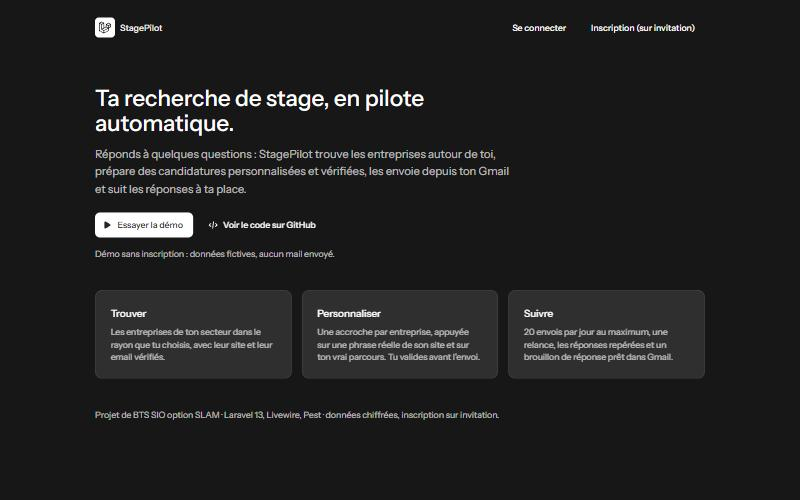
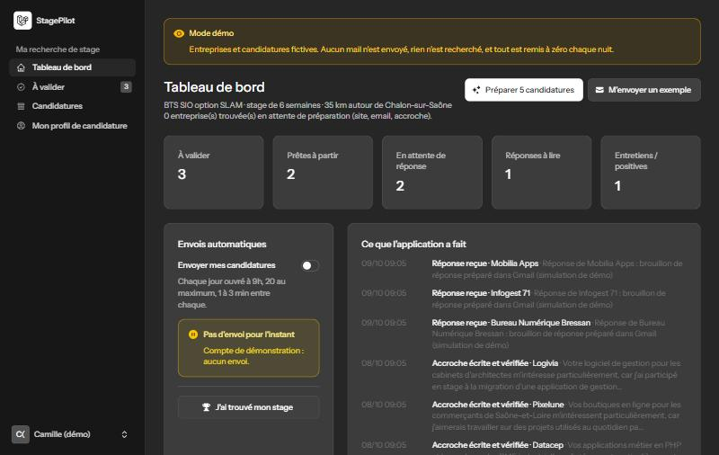
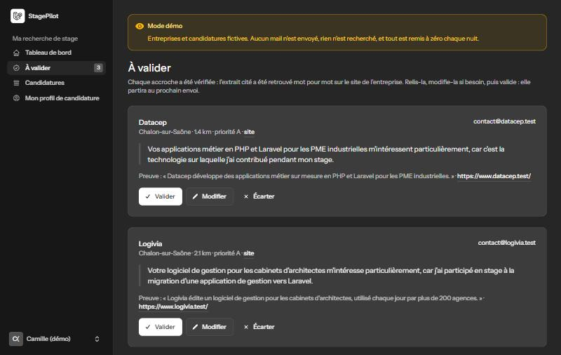
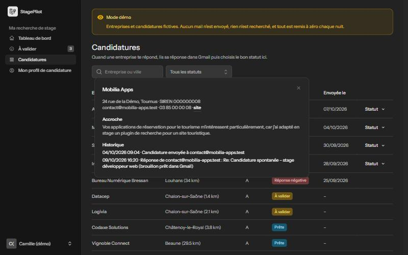
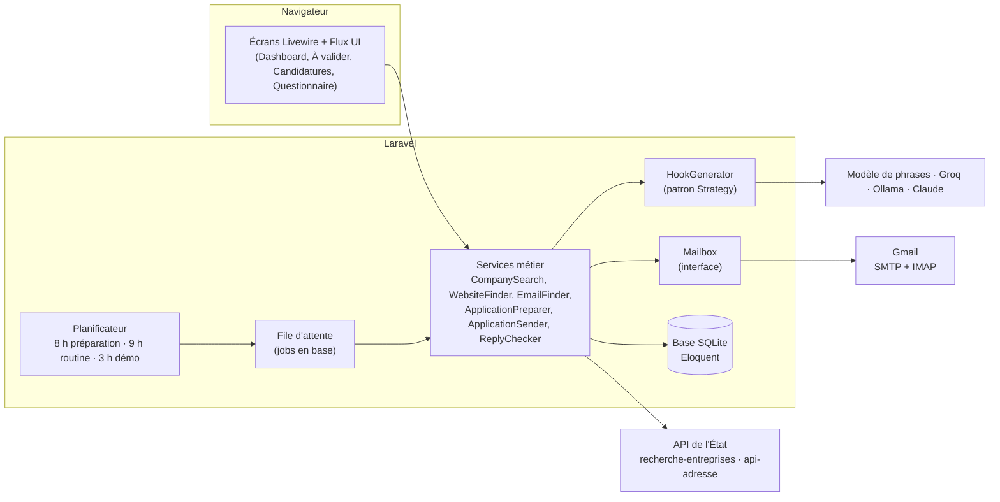
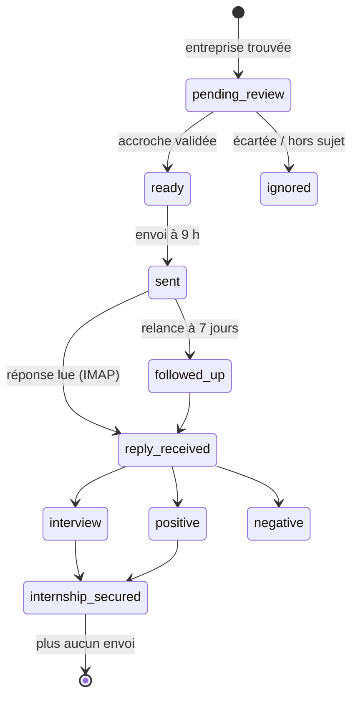
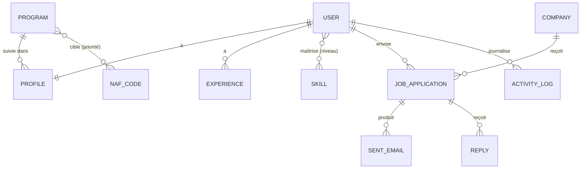

# StagePilot

[](https://github.com/mohamed-ali-akir/stagepilot/actions/workflows/tests.yml)

Application web Laravel qui automatise la recherche de stage d'un étudiant : elle trouve les entreprises autour de lui, prépare une candidature personnalisée **et vérifiée** pour chacune, l'envoie depuis son Gmail après validation, puis suit les réponses.

Projet de BTS SIO option SLAM.

**▶ Essayer : https://akir.alwaysdata.net** → bouton « Essayer la démo » (sans inscription, données fictives, aucun mail envoyé).



| Tableau de bord | Accroches à valider | Suivi des candidatures |
|---|---|---|
|  |  |  |

## Ce que fait l'application

L'étudiant remplit un questionnaire (formation, dates de stage, adresse, expériences, compétences, CV). Ensuite, chaque jour :

1. **8 h – préparation** : recherche des entreprises du secteur dans son rayon (API publique `recherche-entreprises.api.gouv.fr`, filtrée sur les codes NAF de sa formation), de leur site web (gardé seulement s'il affiche le SIREN ou l'adresse) et de leur email ;
2. **accroche vérifiée** : une phrase personnalisée par entreprise, accompagnée d'un **extrait copié du site** que l'application retrouve elle-même sur la page, plus des règles d'honnêteté (pas de « seul », « expert », « j'ai développé »…) ;
3. **validation** : l'étudiant relit, corrige ou écarte chaque accroche ;
4. **9 h – envoi** depuis son Gmail : 20 par jour au maximum, 1 à 3 minutes d'écart, jamais le week-end, une seule relance à 7 jours ;
5. **réponses** : lecture IMAP (en lecture seule), tri des réponses automatiques et des adresses invalides, **brouillon de réponse** préparé dans Gmail (jamais envoyé) ;
6. un **résumé** par mail chaque matin.

## Architecture



- **Services** : toute la logique métier est dans `app/Services`, les écrans Livewire ne font qu'appeler ces services.
- **Interfaces** : Gmail (`Mailbox`) et l'écriture des accroches (`HookGenerator`) sont derrière des interfaces. En test, on les remplace par des faux : aucun mail n'est envoyé, aucune IA n'est appelée.
- **Tâches de fond** : la préparation et les envois espacés passent par la file d'attente de Laravel, déclenchée par le planificateur (une tâche cron toutes les 10 minutes en production).

### Cycle de vie d'une candidature



### Modèle de données



Détail des attributs, cardinalités, règles de gestion et MLD : [docs/MCD.md](docs/MCD.md).

## Choix techniques

| Choix | Pourquoi |
|---|---|
| **Laravel 13 + Livewire 4** | Un seul langage (PHP) pour le serveur et les écrans interactifs ; Livewire évite d'écrire une API juste pour l'interface. |
| **Eloquent + migrations** | Clés étrangères, contraintes d'unicité (une candidature par étudiant et par entreprise, `Message-ID` unique), suppressions en cascade. |
| **File d'attente + planificateur** | Les envois sont espacés de 1 à 3 minutes sans bloquer la page ; tout se déclenche seul à heure fixe. |
| **Chiffrement** | Le mot de passe d'application Gmail est stocké chiffré (cast `encrypted`), jamais affiché. |
| **Patron Strategy** | Le moteur des accroches se choisit dans `.env` sans toucher au code ; tous passent la même vérification. |
| **SQLite** | Suffisant pour quelques utilisateurs, aucune configuration ; passage à MySQL prévu. |
| **Inscription sur invitation + démo** | En ligne, personne ne peut créer de compte pour envoyer des mails ; la démo permet quand même de tout voir. |

### Qui écrit les accroches ? (`HOOK_PROVIDER`)

| Moteur | Coût | Résultat du test sur 9 vraies entreprises |
|---|---|---|
| `template` (par défaut) | gratuit, sans IA | honnête mais générique |
| `groq` (gpt-oss-120b) | gratuit (limite ~2/min) | le meilleur gratuit, exagère parfois le rôle de l'étudiant : relecture obligatoire |
| `ollama` (IA locale) | gratuit | invente des faits : relecture obligatoire |
| `claude` / `mistral` | payants | `claude` : le plus précis |

## Sécurité et garde-fous

- Chaque étudiant ne voit et ne modifie que ses propres candidatures (requêtes limitées à l'utilisateur connecté, testé).
- Au maximum 2 candidatures de la plateforme par entreprise et par mois ; « Ne pas contacter » bloque l'entreprise pour tous.
- Les envois sont **en pause** à la création du compte ; le statut « stage obtenu » arrête tout.
- L'accroche est revérifiée juste avant chaque envoi.
- **Compte démo** : 4 verrous indépendants empêchent tout envoi (pas de mot de passe Gmail, `canSendEmails()`, tâches du matin qui l'ignorent, `GmailMailbox` qui le refuse) ; paramètres du compte bloqués ; remise à zéro chaque nuit.
- Protection CSRF, mots de passe hachés, double authentification et clés d'accès (Fortify).

## Installation

```bash
composer install
npm install && npm run build
cp .env.example .env
php artisan key:generate
php artisan migrate --seed          # tables + formations et codes NAF
php artisan stagepilot:demo-reset   # (facultatif) le compte démo
```

Dans `.env` : `HOOK_PROVIDER` (et la clé du moteur choisi), `INVITED_EMAILS` (adresses autorisées à s'inscrire), `MAIL_MAILER`.

```bash
php artisan serve          # l'application, sur http://localhost:8000
php artisan queue:work     # les tâches en arrière-plan (préparation, envois espacés)
php artisan schedule:work  # le planning : 8 h préparation, 9 h routine, 3 h démo
```

| Commande | Effet |
|---|---|
| `php artisan stagepilot:prepare --user=1 --now` | Prépare les prochaines candidatures d'un étudiant, tout de suite |
| `php artisan stagepilot:morning --user=1` | Lit les réponses, programme les envois du jour, envoie le résumé |
| `php artisan stagepilot:demo-reset` | Remet le compte démo à zéro |

Mise en ligne (alwaysdata) : [deploy/README.md](deploy/README.md).

## Tests et qualité

```bash
php artisan test        # 150+ tests Pest (Gmail et les IA sont simulés)
composer lint:check     # style de code (Laravel Pint)
composer types:check    # analyse statique (PHPStan / Larastan)
```

Les trois sont lancés par **GitHub Actions** à chaque push (badge en haut de page).

## Structure

| Dossier | Rôle |
|---|---|
| `app/Livewire` | Les écrans : `Onboarding` (questionnaire), `Dashboard`, `Review` (à valider), `Applications` (suivi) |
| `app/Services` | La logique métier, dont `DemoAccount` (le compte démo) |
| `app/Services/Hooks` | Les accroches : `HookRules` (règles d'honnêteté), `HookVerifier` (preuve sur le site), un `HookGenerator` par moteur |
| `app/Services/Mail` | L'accès à Gmail derrière l'interface `Mailbox` |
| `app/Jobs`, `app/Console/Commands`, `routes/console.php` | Les tâches de fond et le planning |
| `app/Enums` | Statuts et types (candidature, expérience, réponse…) |
| `tests` | Les tests Pest : règles, vérification, recherche, envoi, réponses, écrans, démo |

---

Projet réalisé avec un développement assisté par IA : le code est généré par Claude Code ; l'étudiant a défini le besoin, pris les décisions et validé chaque étape.
