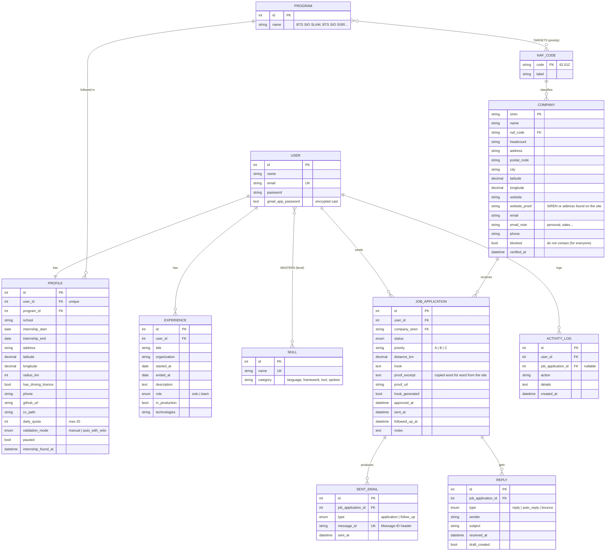

# StagePilot : modèle conceptuel de données (MCD)

Application de recherche de stage : l'étudiant répond à un questionnaire (formation, dates,
localisation, expériences), l'application trouve les entreprises autour de lui, écrit des
accroches vérifiées, envoie les candidatures depuis son Gmail, suit les réponses et relance.

> Statut : **proposition à valider** avant d'écrire les migrations.
> Convention : **tout le code est en anglais** (tables, colonnes, modèles, valeurs d'enum) ;
> les explications de ce document restent en français.

## Schéma

## Associations et cardinalités (Merise)

| Association | Cardinalités | Remarque |
|---|---|---|
| USER — has — PROFILE | 1,1 — 1,1 | créé à la fin du questionnaire |
| PROFILE — follows — PROGRAM | 1,1 — 0,n | |
| PROGRAM — **TARGETS** — NAF_CODE | 0,n — 0,n | porteuse : `priority` (A/B/C). Ex. SLAM → 62.01Z en A, 95.11Z en C |
| USER — has — EXPERIENCE | 0,n — 1,1 | |
| USER — **MASTERS** — SKILL | 0,n — 0,n | porteuse : `level` (basic / good / very_good) |
| COMPANY — classified by — NAF_CODE | 1,1 — 0,n | |
| USER — **APPLIES TO** — COMPANY | 0,n — 0,n | porteuse → entité JOB_APPLICATION (statut, accroche, preuve, dates) |
| JOB_APPLICATION — produces — SENT_EMAIL | 0,n — 1,1 | 1 candidature + 0 ou 1 relance |
| JOB_APPLICATION — gets — REPLY | 0,n — 1,1 | |
| USER — logs — ACTIVITY_LOG | 0,n — 1,1 | |

## Règles de gestion

1. Un utilisateur ne candidate **qu'une fois** par entreprise (clé unique `user_id + company_siren`).
2. Le catalogue COMPANY est **partagé** : un site ou un email trouvé sert à tous les utilisateurs.
3. Une entreprise reçoit **au plus 2 candidatures de la plateforme par mois** (tous utilisateurs confondus).
4. Une entreprise `blocked` (demande « ne plus me contacter ») n'est plus jamais contactée.
5. Statuts (`status`) : `pending_review` → `ready` → `sent` → `followed_up`, puis `reply_received` →
   `positive` | `negative` | `interview` | `internship_secured` ; ou `ignored` / `do_not_contact`.
6. Une accroche (`hook`) n'est valable que si elle respecte les règles d'honnêteté **et** si
   `proof_excerpt` est retrouvé sur la page `proof_url` du site de l'entreprise.
7. En mode `auto_with_veto`, une accroche écrite automatiquement ne part pas le jour même.
8. Au plus `daily_quota` (≤ 20) mails par utilisateur et par jour ; pas d'envoi le week-end, les jours
   fériés, ni dans les 15 jours avant `internship_start`.
9. Une seule relance, 7 jours après l'envoi, si aucune réponse.
10. Dès qu'une candidature passe en `internship_secured`, plus aucun envoi pour cet utilisateur.
11. Chaque `message_id` est unique : registre anti-doublon, et lien entre une réponse et sa candidature.
12. Une EXPERIENCE avec `role = team` ne peut jamais être présentée comme un travail fait seul
    (« j'ai développé seul… » est refusé par le vérificateur d'accroches).

## MLD (modèle logique)

- users (**id**, name, email, password, gmail_app_password*) — *chiffré (cast `encrypted`)
- programs (**id**, name)
- naf_codes (**code**, label)
- naf_code_program (**#program_id, #naf_code**, priority)
- profiles (**id**, #user_id UNIQUE, #program_id, school, internship_start, internship_end, address, latitude, longitude, radius_km, has_driving_licence, phone, github_url, cv_path, daily_quota, validation_mode, paused, internship_found_at)
- experiences (**id**, #user_id, title, organization, started_at, ended_at, description, role, in_production, technologies)
- skills (**id**, name UNIQUE, category)
- skill_user (**#user_id, #skill_id**, level)
- companies (**siren**, name, #naf_code, headcount, address, postal_code, city, latitude, longitude, website, website_proof, email, email_note, phone, blocked, verified_at)
- job_applications (**id**, #user_id, #company_siren, status, priority, distance_km, hook, proof_excerpt, proof_url, hook_generated, approved_at, sent_at, followed_up_at, notes) UNIQUE(user_id, company_siren)
- sent_emails (**id**, #job_application_id, type, message_id UNIQUE, sent_at)
- replies (**id**, #job_application_id, type, sender, subject, received_at, draft_created)
- activity_logs (**id**, #user_id, #job_application_id NULL, action, details, created_at)

Modèles Eloquent : `User`, `Profile`, `Program`, `NafCode`, `Experience`, `Skill`, `Company`,
`JobApplication`, `SentEmail`, `Reply`, `ActivityLog`.
Noms évités volontairement : `Application` et `Message` (déjà utilisés par Laravel).

## Correspondance avec le prototype Python (projet stage_bts)

| Prototype | StagePilot |
|---|---|
| `prospects_chalon.xlsx` (onglet Suivi) | `companies` + `job_applications` |
| `envois.csv` | `sent_emails` |
| `preuves_accroches.csv` | `job_applications.proof_excerpt / proof_url` |
| `journal.txt` | `activity_logs` |
| `config.py` (infos perso, quotas) | `profiles` |
| profil « ne jamais exagérer » | `experiences.role` + `in_production` |
| `prospects.py`, `sites.py`, `emails.py` | jobs `SearchCompanies`, `FindWebsite`, `FindEmail` |
| `regles_accroches.py` + tâche Claude | job `GenerateHook` (API Claude) + service `HookVerifier` |
| `envoi.py`, `reponses.py`, `matin.py` | jobs `SendJobApplication`, `CheckReplies`, `SendDailyDigest` + planificateur |
