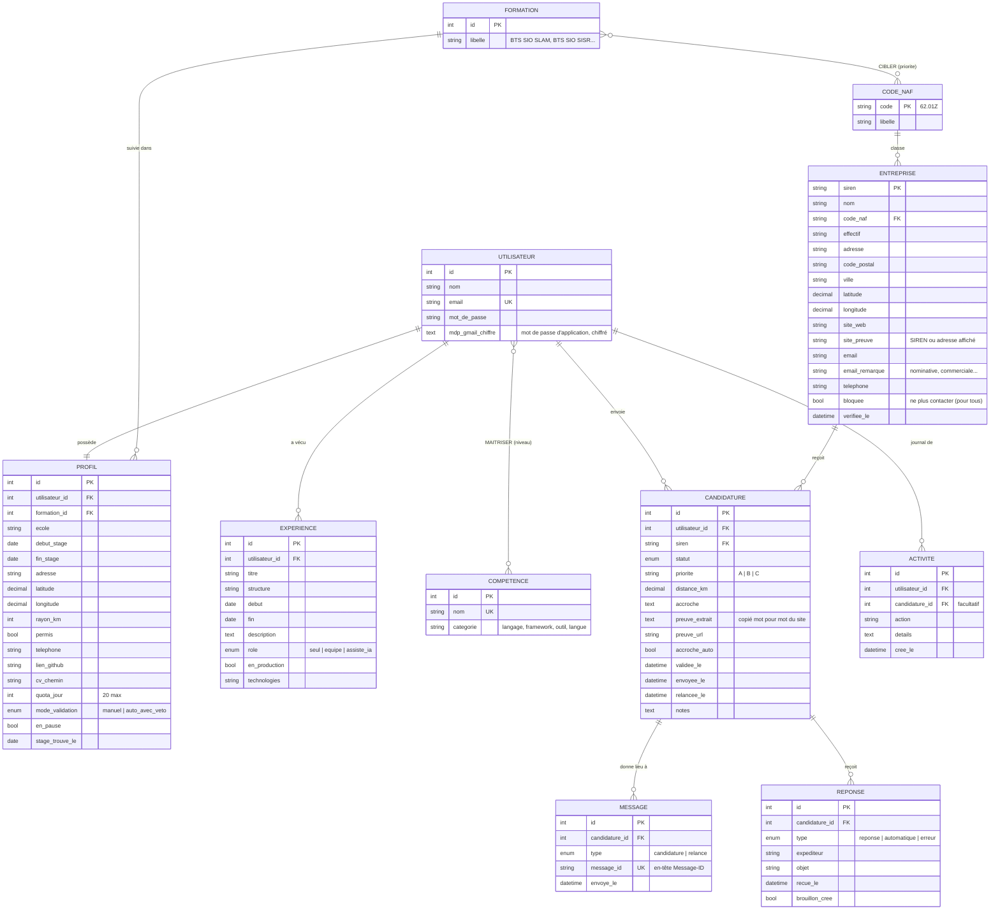

# StagePilot : modèle conceptuel de données (MCD)

Application de recherche de stage : l'étudiant répond à un questionnaire (formation, dates,
localisation, expériences), l'application trouve les entreprises autour de lui, écrit des
accroches vérifiées, envoie les candidatures depuis son Gmail, suit les réponses et relance.

> Statut : **proposition à valider** avant d'écrire les migrations.

## Schéma

## Associations et cardinalités (Merise)

| Association | Cardinalités | Remarque |
|---|---|---|
| UTILISATEUR — POSSÈDE — PROFIL | 1,1 — 1,1 | créé à la fin du questionnaire |
| PROFIL — SUIT — FORMATION | 1,1 — 0,n | |
| FORMATION — **CIBLER** — CODE_NAF | 0,n — 0,n | porteuse : `priorite` (A/B/C). Ex. SLAM → 62.01Z en A, 95.11Z en C |
| UTILISATEUR — A VÉCU — EXPERIENCE | 0,n — 1,1 | |
| UTILISATEUR — **MAÎTRISER** — COMPETENCE | 0,n — 0,n | porteuse : `niveau` (notions / bon / très bon) |
| ENTREPRISE — CLASSÉE — CODE_NAF | 1,1 — 0,n | |
| UTILISATEUR — **CANDIDATER** — ENTREPRISE | 0,n — 0,n | porteuse → entité CANDIDATURE (statut, accroche, preuve, dates) |
| CANDIDATURE — DONNE LIEU À — MESSAGE | 0,n — 1,1 | 1 candidature, 0 ou 1 relance |
| CANDIDATURE — REÇOIT — REPONSE | 0,n — 1,1 | |
| UTILISATEUR — JOURNAL — ACTIVITE | 0,n — 1,1 | |

## Règles de gestion

1. Un utilisateur ne peut candidater **qu'une fois** par entreprise (clé unique `utilisateur_id + siren`).
2. Le catalogue ENTREPRISE est **partagé** : un site ou un email trouvé sert à tous les utilisateurs.
3. Une entreprise reçoit **au plus 2 candidatures de la plateforme par mois** (tous utilisateurs confondus).
4. Une entreprise `bloquee` (demande « ne plus me contacter ») n'est plus jamais contactée.
5. Statuts d'une candidature : `a_valider` → `prete` → `envoyee` → `relancee`, puis
   `reponse_recue` → `positive` | `negative` | `entretien` | `stage_obtenu` ; ou `ignoree` / `ne_pas_contacter`.
6. Une accroche n'est valable que si elle respecte les règles d'honnêteté **et** si `preuve_extrait`
   est retrouvé sur la page `preuve_url` du site de l'entreprise.
7. En mode `auto_avec_veto`, une accroche écrite automatiquement ne part pas le jour même.
8. Au plus `quota_jour` (≤ 20) mails par utilisateur et par jour ; pas d'envoi le week-end, les jours
   fériés, ni après `fin_stage - 15 jours`.
9. Une seule relance, 7 jours après l'envoi, si aucune réponse.
10. Dès qu'une candidature passe en `stage_obtenu`, plus aucun envoi pour cet utilisateur.
11. Chaque `message_id` est unique : c'est le registre anti-doublon et ce qui relie une réponse à sa candidature.
12. Les EXPERIENCE portent le `role` réel (seul / en équipe / assisté par IA) : l'IA ne peut pas écrire
    « j'ai développé seul » si le rôle est `equipe` ou `assiste_ia`.

## MLD (modèle logique)

- users (**id**, name, email, password, gmail_app_password*)  *chiffré (cast `encrypted`)
- formations (**id**, libelle)
- codes_naf (**code**, libelle)
- formation_code_naf (**#formation_id, #code_naf**, priorite)
- profils (**id**, #user_id UNIQUE, #formation_id, ecole, debut_stage, fin_stage, adresse, latitude, longitude, rayon_km, permis, telephone, lien_github, cv_chemin, quota_jour, mode_validation, en_pause, stage_trouve_le)
- experiences (**id**, #user_id, titre, structure, debut, fin, description, role, en_production, technologies)
- competences (**id**, nom UNIQUE, categorie)
- competence_user (**#user_id, #competence_id**, niveau)
- entreprises (**siren**, nom, #code_naf, effectif, adresse, code_postal, ville, latitude, longitude, site_web, site_preuve, email, email_remarque, telephone, bloquee, verifiee_le)
- candidatures (**id**, #user_id, #siren, statut, priorite, distance_km, accroche, preuve_extrait, preuve_url, accroche_auto, validee_le, envoyee_le, relancee_le, notes) UNIQUE(user_id, siren)
- messages (**id**, #candidature_id, type, message_id UNIQUE, envoye_le)
- reponses (**id**, #candidature_id, type, expediteur, objet, recue_le, brouillon_cree)
- activites (**id**, #user_id, #candidature_id NULL, action, details, created_at)

## Correspondance avec le prototype Python (projet stage_bts)

| Prototype | StagePilot |
|---|---|
| `prospects_chalon.xlsx` (onglet Suivi) | `entreprises` + `candidatures` |
| `envois.csv` | `messages` |
| `preuves_accroches.csv` | `candidatures.preuve_extrait / preuve_url` |
| `journal.txt` | `activites` |
| `config.py` (infos perso, quotas) | `profils` |
| profil « ne jamais exagérer » | `experiences.role` + `en_production` |
| `prospects.py`, `sites.py`, `emails.py` | jobs `RechercherEntreprises`, `TrouverSite`, `TrouverEmail` |
| `regles_accroches.py` + tâche Claude | job `EcrireAccroche` (API Claude) + service `VerificateurAccroche` |
| `envoi.py`, `reponses.py`, `matin.py` | jobs `EnvoyerCandidature`, `VerifierReponses`, `ResumeQuotidien` + planificateur |
